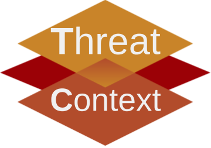

## Installation

This is for a simple docker based installation
```bash
git clone https://github.com/badluck-125/ThreatContext.git
cd ThreatContext
docker compose up -d
```

If you want to input data from exploitDB, run the input script.
You need to install clone the [exploitDB gitlab](https://gitlab.com/exploit-database/exploitdb) repo first.

```bash
bash input_script/input_exploitDB.bash
```
You can then connect to the presentation tier using this url
http://127.0.0.1:8080/

Or you can connect to the application tier directly using this url
http://127.0.0.1:8090/

## API

You can interact with the application with the application tier API endpoint.

| Use | API Endpoint | Input | Output |
| --- | ------------ | ----- | ------ |
| Add CVE to ThreatContext | /cve-entry | cve_id(req), exploit_id, ioc_id, platfrom, cve_source | 0=created or 'Insert failed' |
| Add exploit to ThreatContext | /exploit-entry | exploit_type, exploit_content, exploit_source | 0=created or 'Insert failed' |
| Add Sample to ThreatContext | /sample-entry | platform(req), title, poi, sample_content, sample_source | 0=created or 'Insert failed' |
| Add IoC to ThreatContext | /ioc-entry | ioc_type, ioc_content | 0=created or 'Insert failed' |
| Request IoC (RAG) | /ioc-request | cve_id(req) | 0={ioc_id, ioc_type, ioc_content} or 'No IoC were found' |
| Update a CVE in ThreatContext | /cve-update | id(req), cve_id, exploit_id, ioc_id, platfrom, cve_source | 0=true or 'unknown cve id' |
| Update an exploit in ThreatContext | /exploit-update | id(req), exploit_id, exploit_type, exploit_content, exploit_source | 0=updated or 'Insert failed' |
| Update a sample in ThreatContext | /sample-update | id(req), platform, title, poi, sample_content, sample_source | 0=updated or 'Insert failed' |
| Update an IoC in ThreatContext | /ioc-update | id(req), ioc_id, ioc_type, ioc_content | 0=created or 'Insert failed' |
| Consult CVE in ThreatContext | /cve-consult | cve_id(req) | 0={id, cve_id, exploit_id, ioc_id, platform, cve_source, date_added, date_modified} or 'Insert failed' |
| Consult Exploit in ThreatContext | /exploit-consult | exploit_id(req) | 0={id, exploit_id, exploit_type, exploit_source, date_added, date_modified} or 'Insert failed' |
| Consult sample in ThreatContext | /sample-consult | platform(req) | 0={id, platform, title, point_of_interest, sample_content, sample_source, date_added, date_modified} or 'Insert failed' |
| Consult IoC in ThreatContext | /ioc-consult | ioc_id(req) | 0={id, ioc_id, ioc_type, ioc_content, date_added, date_modified} or 'Insert failed' |
| Delete CVE in ThreatContext | /cve-delete | cve_id(req) | 0='deleted' or 'Missing or invalid parameter' |
| Delete exploit in ThreatContext | /exploit-delete | exploit_id(req) | 0='deleted' or 'Missing or invalid parameter' |
| Delete sample in ThreatContext | /sample-delete | sample_id(req) | 0='deleted' or 'Missing or invalid parameter' |
| Delete IoC in ThreatContext | /ioc-delete | sample_id(req) | 0='deleted' or 'Missing or invalid parameter' |

## Roadmap
Things to add to ThreatContext
1. Create an input script for the [vulnerability-poc](https://github.com/fankh/vulnerability-poc) repo
2. Create an input script for a set of sample
3. Improve data categorization to enhance application tier flexibility
4. Transform database schema to be STIX 2.X compliant
5. Add a TAXII server on the application tier to transport STIX data
6. Hardenning: Add API token authentication/right
7. Hardenning: Add a session features for the presentation tier
